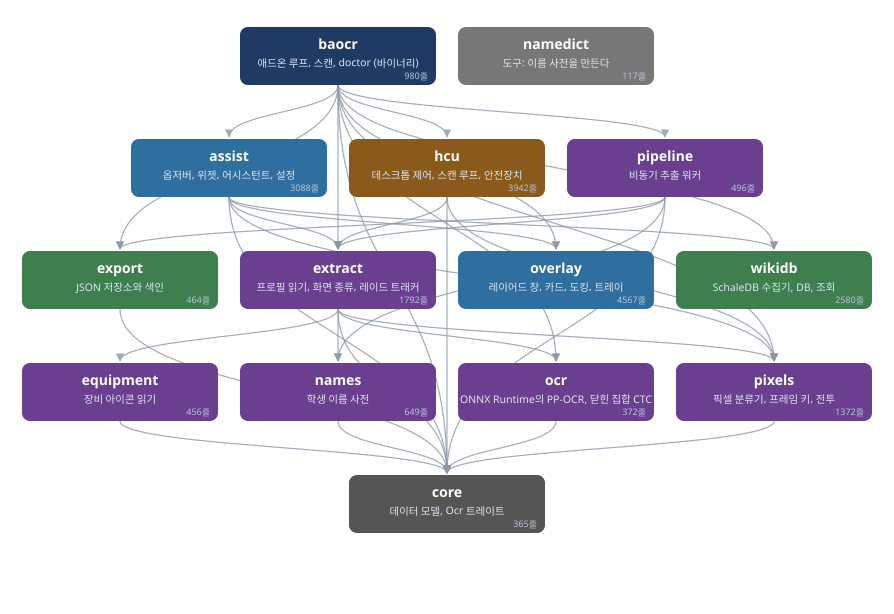

# Blue Archive add-on

A Windows add-on for Blue Archive (Global server, Korean UI, 4:3 windowed). It reads the game screen,
looks the mission or raid up in a local database, and shows a card and icons next to or over the game
window. It can also scan the student roster into JSON when you press a button.

## What it does

| Feature | Sends input to the game |
|---|---|
| Guide card: screen name, mission or raid facts, enemy armor and attack mix, squad verdict | no |
| Icons on the quick formation popup: a fit grade and the terrain face per student and slot | no |
| Raid screens: 총력전, 모의총력전, 제약해제결전, 종합전술시험, 대결전 (card with the raid's armor and attack mix) | no |
| Battle mode: the add-on goes quiet during a fight | no |
| Student roster scan (`students.json`, `index.json`, `details/NNN/student.json`) | yes, only after you press the scan button |

The card always shows the add-on's state. Closing the add-on is the power icon in the card header,
or the tray icon (right click, 종료), which works even when the windows are stuck.

## Run it

1. Use the portable build: `pwsh scripts/package-portable.ps1` writes `D:\dist\ba-scanner` with
   `ba-scanner.exe`, `models/`, `wikidb/` and `DirectML.dll`. Start `ba-scanner.exe`, before or after the game.
2. Set the game to 4:3, windowed, and turn Windows HDR off (HDR washes out the colours the readers use).
3. The card appears beside the game. If the monitor has no room beside it, the card becomes a bookmark
   tab inside the game and unfolds when the pointer is on it.

Settings are in `%APPDATA%\baocr\overlay.json`, scan output in `%APPDATA%\baocr\students`, the input log in
`%APPDATA%\baocr\input.log`, and fatal errors in `%APPDATA%\baocr\error.log`.

## Card behaviour

- Placement is one of four anchors: outside left or right, inside top left or right. Drag the header, or
  the folded tab, to move it. It snaps to the nearest anchor and remembers it. Details: [docs/card-dock.md](docs/card-dock.md).
- The pin button in the header keeps the card open. Without it, an inside card folds into a tab.
- The student list section folds. A folded section still shows how long ago the list was scanned, and a
  tooltip shows the exact time.
- While a scan runs, your mouse and keyboard are blocked except for the scan's own input. ESC stops the
  scan and gives control back. The card says so.

## Commands

Build once with `cd rust && cargo build --release`, then:

| Command | What it does |
|---|---|
| `baocr` or `baocr --assist` | the add-on |
| `baocr --doctor` | checks the game window, DPI, monitors, elevation and focus; sends no input |
| `baocr --scan-arrows --from-first --out scan` | scans the roster from the command line; add `--fast` to skip the menu pass |
| `baocr --reextract scan [--ids 003,007]` | rereads saved frames, no game input |
| `baocr --watch --out db` | passive updater |
| `baocr --learn shots` | saves every new screen and its text while you play, no input |
| `baocr --image fixtures/detail-shun.png --out out` | parses one saved screenshot |
| `cargo run -p baocr-wikidb --release` | builds `wikidb/wiki.db` from SchaleDB |
| `cargo run -p baocr-namedict` | refreshes the name dictionary after a patch |

Environment variables: `BAOCR_MODELS` (model folder), `BAOCR_OCR_DEVICE=cpu` (skip the GPU),
`BAOCR_HCU=process` (use the old helper program), `BAOCR_PROFILE=1` (stage timings),
`BAOCR_INPUT_LOG=0` (no input log), `BAOCR_HCU_SETTLE_MS` (wait after input), `BAOCR_STATE_DUMP=<file>` (write
the add-on's state for the live test), `BAOCR_OVERLAY_CAPTURABLE=1` (let screenshots include the overlay).

## Requirements

- Windows 10 or 11, the game in 4:3 windowed mode, one game window.
- OCR models in `models/` (see [models/README.md](models/README.md)) and the wiki database in `wikidb/wiki.db`
  (a local build, not redistributed).
- A GPU with DirectML speeds up OCR about 2.7 times; the CPU works too.
- Build output: set `CARGO_TARGET_DIR` to a drive with space. The repository limits debug info and parallel
  jobs so test builds fit in memory ([ADR 0009](docs/adr/0009-build-limits.md)).

## Documentation

| Page | Contents |
|---|---|
| [docs/ARCHITECTURE.md](docs/ARCHITECTURE.md), [docs/architecture.html](docs/architecture.html) | modules, runtime flow, static and dynamic data, threads |
| [docs/adr/](docs/adr/README.md) | nine decision records |
| [docs/hcu-native.md](docs/hcu-native.md) | desktop control in process, input guards, `activate` policy |
| [docs/raid-data.md](docs/raid-data.md) | raid tables, seasons, lookups, raid screens |
| [docs/enemy-weighting.md](docs/enemy-weighting.md) | how armor and attack shares are weighted by HP, with sources |
| [docs/card-dock.md](docs/card-dock.md) | anchors, bookmark tab, hover timings, snapping |
| [docs/speed-research.md](docs/speed-research.md) | where the latency goes, measured options, DirectML |
| [docs/live-e2e.md](docs/live-e2e.md) | the live test against the real game |
| [rust/PORTING.md](rust/PORTING.md) | module contracts from the Go port |
| [docs/history/](docs/history) | notes from the Go and Tesseract era |

## Status

Verified by tests and by live runs: scene recognition on the raid screens, boss cards against the database,
the stale icon fix, fold, pin and hover, the input guards. Not yet verified live: the 106 student scan on
the in-process input path, the CPU against DirectML comparison, click to card latency under 1 s (the last
measurement was 1.7 s median, taken while a faulty touch screen was sending input), real ESC and the input
lock, the tray menu, and DirectML's effect on the game's frame rate.

Known gaps: a raid has up to four parties but the verdict covers the party being edited; scrolled Insane and
higher rows, the real 대결전 screen and the 종합전술시험 stages are not learned; the 3-digit bond rank has no
sample; equipment icons beyond tier 4 are unverified; layouts other than 4:3 windowed are unsupported.

## History

The first implementation was Go with Tesseract. The Rust port replaced it after matching it on all 106 saved
frames and in a live full scan. The helper-process desktop control was replaced by in-process Win32 calls
([ADR 0003](docs/adr/0003-native-desktop-control.md)); `vendor/hcu` stays until the live scan comparison passes.
