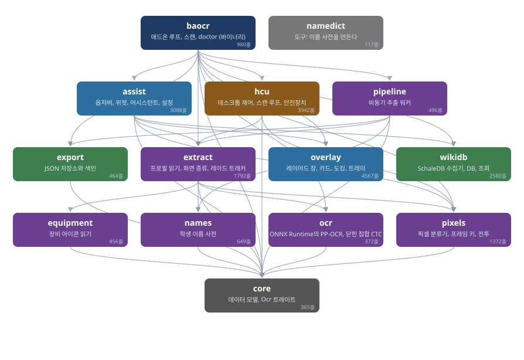

# 아키텍처

애드온은 Windows 프로그램 하나(`baocr`, Rust로 작성)다. Blue Archive 창 옆에서 OCR과 픽셀 검사로 게임이 보여주는
내용을 읽고, 게임 위에 그린 카드와 아이콘으로 답한다. 명단 읽기는 플레이어가 직접 시작하는 별도 기능이다. 모든
동작이 한 프로세스 안에서 돈다.

다이어그램이 있는 HTML 판은 [architecture.html](architecture.html)에 있다. 결정마다 [adr/](adr/README.md) 아래에
기록이 하나씩 있다. 이 문서는 전체 지도 역할을 한다.

## 기능

| 기능 | 게임에 보내는 입력 | 위치 |
|---|---|---|
| 수동 관찰 안내: 화면 종류 표시, 임무와 레이드 카드, 편성 판정, 초상화와 슬롯 아이콘 | 없음(스크린샷만) | `assist`, `overlay`, `extract` |
| 학생 명단 스캔(JSON 출력) | 클릭과 스크롤, 플레이어가 버튼을 누른 뒤에만 | `hcu`, `cli` |
| 새 픽스처를 위한 화면 학습(`probe`, `--learn`) | 없음, 또는 개발자가 보내는 이동 클릭 | `cli/examples` |

## 실행 흐름

```
 game window ──► capture ──► settle check ──► OCR / pixel tests ──► scene + keys ──► Observation
   (Win32)       (hcu)       (frame key)       (ocr, extract,         (extract)         │
                                                pixels)                                  ▼
 overlay thread ◄── Surface ◄── Assistant ◄── widgets (wikidb lookups, matchup, weights)
 (layered windows)  (trait)     (diffing)       static DB data

 player ──► card buttons ──► events ──► Assistant ──► settings / commands (scan, quit)
```

1. 루프(`cli/src/assist.rs`)가 게임 클라이언트를 1280x960 프레임으로 캡처한다. 값싼 프레임 키로 화면이 움직이는지
   멈췄는지 판단하고, 픽셀 몇 개로 전투를 감지한다.
2. 루프가 아직 보지 못한 안정된 화면에서 OCR을 한 번 돌린다. `extract`가 머리글과 앵커 단어로 화면 종류를
   분류하고, 트래커(`MissionTracker`, `RaidTracker`)가 플레이어가 고른 것을 기억한다. 이후 화면에는 그 선택이
   나오지 않기 때문이다.
3. `Observer`가 프레임을 `Observation`으로 바꾼다. `Observation`은 화면 종류, 임무나 레이드 키, 편성, 격자 카드를
   담는다.
4. `Assistant`가 모든 `Widget`에 무엇을 보여줄지 묻고, 정적 위키 DB에서 정보를 찾고, 바뀐 출력만 `Surface`로
   보낸다.
5. `Overlay`가 `Surface`를 구현한다. 자체 스레드가 카드, 게임 내 카드, 아이콘, 툴팁을 레이어드 창으로 그리고,
   버튼 클릭을 이벤트로 돌려보낸다.

## 정적 데이터와 동적 데이터

화면은 조회 키만 제공한다. 정보는 데이터베이스에서 가져온다([ADR 0005](adr/0005-static-db-dynamic-screen.md)).

| 데이터 | 종류 | 출처 |
|---|---|---|
| 어떤 화면인지, 어떤 임무, 스테이지, 레이드 보스, 난이도, 모드인지 | 동적 | OCR과 픽셀 |
| 편성에 어떤 학생이 있는지, 그 슬롯 | 동적 | 이름 OCR, 닫힌 집합 읽기 |
| 지형 탭, 선택 상태 | 동적(읽을 수 있을 때) | 픽셀 |
| 스테이지의 적 방어 타입과 공격 타입 비중, 레벨, 지형 | 정적 | `wikidb/wiki.db` |
| 학생의 공격 타입과 방어 타입, 지형 적응, 역할 | 정적 | `wikidb/wiki.db` |
| 타입 상성표, 적 가중치 | 정적 | `wikidb/wiki.db` |
| 설정, 도킹 위치, 접기 상태 | 사용자 상태 | `%APPDATA%\baocr\overlay.json` |
| 스캔 출력 | 생성 데이터 | `%APPDATA%\baocr\students` |

### 스캔 없이 하는 일과 스캔 후에 할 일

스캔은 사용자마다 다른 값(레벨, 성장 단계, 아이템 레벨, 인연 랭크)을 모으려는 기능이다. 학생의 고정 정보는 스캔과 무관하게 항상 데이터베이스에서 읽는다. 빠른 편성 초상화 아이콘이 그 예로, 임무를 알면 적합도와 지형 표정을, 임무를 모르면 공격 타입, 방어 타입, 지형 표정을 그린다. 스캔 파일이 없어도 같은 아이콘이 나온다.

스캔 데이터가 필요한 기능은 아직 구현하지 않았다. 계획만 있다. 보유 학생 중에서 상성, 레벨과 성장 상태, 포지션(수비, 공격, 저격)을 함께 따져 전투별로 탱커 1~3순위와 딜러 1~3순위를 추천하는 기능이다. 지금 목표는 정적 정보를 보여 주어 사용자가 직접 고르게 하는 데까지다.

## 모듈



그래프는 `python scripts/gen_arch.py`가 `cargo metadata`에서 생성한다. Mermaid 형식은
[diagrams/crates.mmd](diagrams/crates.mmd)에 있다.

| 크레이트 | 책임 | 비고 |
|---|---|---|
| `baocr` (cli) | 애드온 루프, 스캔 드라이버, `--doctor`, 학습과 측정용 예제 | 사용자가 실행하는 유일한 바이너리 |
| `assist` | `Observer`, `Widget`, `Assistant`, 설정, 레이드 조회, 상성 문구 | 그리기와 게임 접근이 없다. `Surface`가 출력 포트다 |
| `overlay` | 레이어드 창, 패널과 아이콘 렌더링, 배치와 접기, 트레이, 입력 훅 | Win32는 여기와 `hcu`에만 있다 |
| `hcu` | 프로세스 내 데스크톱 제어: 캡처, 줌, 클릭, 스크롤, 창 목록. 안전장치, 스캔 루프, doctor | [hcu-native.md](hcu-native.md) |
| `extract` | 프로필 읽기, 화면 종류 분류, 임무와 레이드 트래커, 카드 이름 | 박스와 프레임을 다루는 순수 함수 |
| `ocr` | ONNX Runtime의 PP-OCR 검출과 인식, 닫힌 집합 CTC 점수 | [ADR 0002](adr/0002-ocr-stack.md) |
| `pixels` | 픽셀 분류기, 프레임 키, 전투 감지기, 아이콘 검사 | OCR을 쓰지 않는다 |
| `wikidb` | SchaleDB 수집기, 스키마, 조회, 편성 평가, 레이드 데이터 | [raid-data.md](raid-data.md) |
| `pipeline`, `export`, `names`, `equipment`, `core` | 명단 스캔 백엔드: 비동기 추출, JSON 저장소, 이름 사전, 장비 아이콘, 공용 모델 | |

의존 규칙: `cli`는 `assist`에 의존하고, `assist`는 `overlay`, `extract`, `wikidb`에 의존한다. `hcu`는 `extract`에
의존하고, `extract`는 `ocr`와 `pixels`에 의존한다.
그리기는 `overlay`만 한다. `overlay`는 게임 데이터를 모르고, `assist`가 카드에 낼 내용을 `Surface`로 넘긴다.

## 스레드와 창

| 스레드 | 하는 일 | 하지 않는 일 |
|---|---|---|
| 메인 루프 (`cli`) | 캡처, 읽기, 관찰, 표시, 스캔 실행 | 그리기 |
| 오버레이 워커 (`overlay/win.rs`) | 변경이 있을 때 레이어를 그리고, 호버를 위해 커서를 폴링하고, 클릭을 보고한다 | 화면 읽기 |
| 트레이 (`overlay/tray.rs`) | 알림 아이콘과 그 종료 메뉴를 자체 숨은 창에서 처리한다 | 다른 창에 의존 |
| 입력 차단 (`overlay/input_block.rs`) | 스캔 중에 저수준 훅을 걸고, ESC로 중단한다 | 스캔 밖에서 실행 |
| 입력 힌트 (`overlay/hints.rs`) | 선택 사항인 통과형 마우스 훅(기본 꺼짐, 연결되지 않음) | 입력을 막거나 전달 |

카드는 상호작용하는 레이어드 창이다. 게임 내 카드, 아이콘, 툴팁은 클릭을 통과시킨다. 네 창 모두 화면 캡처에서
제외되므로 애드온이 자기 자신을 읽는 일은 없다.

## 설계를 정하는 제약

- 애드온은 4:3 창 모드의 게임만 읽는다. 관심 영역은 1280x960 클라이언트를 기준으로 보정했다.
- 입력은 스캔에만 보내고, 안전장치를 거친다([ADR 0004](adr/0004-input-policy.md)).
- 게임 메모리나 파일은 읽지 않고 스크린샷과 공개 데이터만 쓴다.
- 빌드 제한이 RAM과 디스크를 지킨다([ADR 0009](adr/0009-build-limits.md)).

## 검증

| 수준 | 내용 | 위치 |
|---|---|---|
| 단위 | 순수 로직: 화면 종류, 트래커, 기하, 호버, 가중치, 안전장치(가짜 데스크톱) | `cargo test --workspace` |
| 픽스처 | 실제 스크린샷과 OCR 박스 | `fixtures/screens` |
| 측정 | 타임라인과 OCR 시간 | `docs/speed-research.md`, `cli/examples/speed_*` |
| 라이브 e2e | 실제 게임에서 돌리는 애드온, 상태 덤프 | [live-e2e.md](live-e2e.md) |
| 사람 | 카드의 시각 품질, 호버 체감, 하드웨어 ESC, 트레이 메뉴, 프레임 속도 | 릴리스 점검 목록 |

## 결정 기록

초기 추출 시기의 노트(Go와 Tesseract, OCR 벤치마크, 인연 랭크, 위험 요소)는
[history/go-era-architecture.md](history/go-era-architecture.md)에 남겨 두었다.

결정 기록의 목록은 [adr/README.md](adr/README.md)에 있다. 상세 노트는 [hcu-native.md](hcu-native.md), [hcu-reference.md](hcu-reference.md),
[raid-data.md](raid-data.md), [card-dock.md](card-dock.md), [speed-research.md](speed-research.md),
[enemy-weighting.md](enemy-weighting.md)다.
